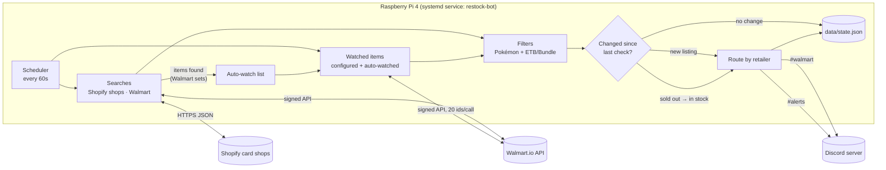

# Pokémon TCG Restock Bot 🚨

A self-hosted Discord bot that watches **Walmart** and independent **Shopify card shops** for Pokémon TCG **Elite Trainer Boxes** and **Booster Bundles**. It posts an alert the moment one is **newly listed** or **back in stock**, and it runs 24/7 on a Raspberry Pi 4.

Every alert includes the price, a product image, a buy link (straight to the cart when the store supports it) and ✅ / ❌ reactions so the server can vote on whether a listing is legit. Walmart alerts go to their own channel, and reseller listings at scalper prices never ping anyone.

---

## ✨ Features

- 🆕 **New-listing alerts:** catches products the moment a store lists them, including preorders
- 🔁 **Restock alerts:** fires when a known listing goes from sold out to available
- 🏬 **Walmart, hands-off:** the bot finds every set's ETB and Booster Bundle pages on its own and checks them every minute. There are no item IDs to look up.
- 🚫 **Scalper filter:** a Walmart item only counts as in stock when Walmart itself sells it, with an optional `max_price`
- 🎯 **Precise filtering:** only Pokémon ETBs and Booster Bundles; single cards, other games and accessories are ignored
- 📺 **Channel per retailer:** for example, every Walmart alert goes to `#walmart`, with optional role pings per retailer or store
- 🛒 **Quick buy links:** links go straight to the cart when the store allows it
- 🗳️ **Community voting:** ✅ / ❌ reactions on every alert
- 🩺 **Self-monitoring:** warns in Discord if a store keeps failing, and again when it recovers
- 🔄 **Survives restarts:** remembers what it has seen, so a reboot never re-posts old alerts
- 📏 **Stays inside API quotas:** batches Walmart lookups and warns at startup if the config would go over the daily limit
- ⚙️ **One YAML file** controls which stores, sets and product types are watched

---

## 🧠 How it works

### The big picture



The bot is one Python process running a loop. Every pass, it asks each store what it has, keeps only Pokémon ETBs and Booster Bundles, compares that with what it saw last time, and posts an alert for anything that's new or newly available.

### One pass, step by step

1. **Scheduler** (`bot/scheduler.py`) wakes up every `check_interval_seconds` (default 60) and runs every check that's due, in parallel. Searches on quota-limited APIs can run less often: Walmart's new-listing search runs every 5 minutes and its per-set search every hour.
2. **Monitors** (`monitors/`) fetch the data:
   - **Shopify shops** expose two public JSON endpoints on every storefront, so no key or scraping is needed. `/search/suggest.json?q=…` returns up to 10 matching products per keyword, and `/products/<handle>.js` returns one product with its publish date.
   - **Walmart** uses the official **Walmart.io Affiliate API**. Every request is signed with your RSA private key. The bot uses two endpoints: search, and an item lookup that takes up to 20 item IDs per call.
3. **Filters** (`utils/text.py`) keep a title only if it mentions Pokémon, is an Elite Trainer Box or Booster Bundle, and contains no excluded word (sleeves, playmats, and so on). Matching ignores case and accents, and words match at their start, so "Pokémon" matches "pokemon" and "tin" matches "Tins" but not "Destined".
4. **Change detection** compares each result with `data/state.json`:
   - **New listing:** a product the bot has never seen. For Shopify, it first checks the product's publish date and only alerts if the product went live in the last 72 hours, because big stores rotate old listings in and out of their top-10 results.
   - **Restock:** a product that was sold out and is now available.
   - **Quiet first pass:** the first check of any new store, search or keyword records what's already listed without alerting, so adding a store never floods the channel.
5. **Routing** (`bot/client.py`) picks the channel and role for each alert. A search's or product's own `channel_id` wins, then the retailer's channel (`retailer_channels`), then the default alerts channel.
6. **Notifier** (`bot/notifier.py`) posts the embed (price, image, buy link, store, and a 🔥 note when Walmart reports low stock), then adds ✅ / ❌.
7. **State** is saved after every pass with an atomic write, so a power cut can't corrupt it.

### How Walmart is watched

Walmart is the hardest store to catch. It has thousands of reseller listings, its restocks sell out in minutes, and its API allows **5,000 calls a day**. The bot handles it in three layers:

| Layer | What it does | How often | API calls/day |
|---|---|---|---|
| **`walmart` search** | Asks for the *newest* ETB / Booster Bundle listings; alerts on any Walmart-sold one it hasn't seen | every 5 min | ~576 |
| **`walmart_sets` search** | Searches each set by name (14 sets × ETB + Booster Bundle) and adds every page it finds to the auto-watch list | hourly | ~672 |
| **Auto-watch** (`bot/autowatch.py`) | Checks every found page, plus any you list yourself, in batched lookups of 20 IDs per call, up to 40 items | every minute | ~2,880 |

That's about **4,130 calls a day**, which leaves headroom for `/walmartfind`. The bot estimates usage at startup and logs a warning if your config would go over about 4,500.

**Resellers:** a listing sold only by a third party counts as **not in stock** and is never announced as new. It stays on the auto-watch list, though, so if Walmart itself starts selling that page, the next minute's check sees "sold out → in stock" and alerts. `max_price` adds a second guard: a listing above it doesn't count either.

### Reliability

- A **failed check never counts as "out of stock"**, so network errors can't cause fake "back in stock" alerts.
- **Exponential backoff with jitter** kicks in after repeated failures, and backs off harder when a site returns HTTP 403 / 429.
- **Polite by design:** at least 2 seconds between requests to the same store website (0.5s for Walmart's quota-based API), and an honest User-Agent that identifies the bot.
- **Health alerts:** after 5 failed checks in a row the bot posts ⚠️ in Discord, then ✅ when the store recovers. Auto-watched items only log their failures, so one Walmart outage doesn't post 40 warnings; the configured items and searches on the same API still raise the alarm.
- **systemd** restarts the bot if it crashes and starts it on boot.

---

## 🧰 Tech stack

| Layer | Technology |
|---|---|
| Language | **Python 3.8+** (3.11 on the Pi) |
| Discord | **discord.py 2.x**: gateway client, slash commands (`app_commands`), embeds, reactions |
| HTTP | **aiohttp** (async, shared connection pool, per-host rate limiting) |
| Concurrency | **asyncio**: every store is checked in parallel on one thread |
| Auth | **cryptography**: RSA SHA-256 request signing for Walmart.io |
| Config | **PyYAML** (`config/config.yaml`) + **python-dotenv** (`.env` for secrets) |
| Store data | **Walmart.io Affiliate API**; **Shopify Ajax API** (predictive search + product JSON); Best Buy Products API (optional) |
| Persistence | JSON file (`data/state.json`) with atomic writes |
| Tests | **pytest**: unit tests plus a real local aiohttp server for HTTP behavior |
| Process manager | **systemd** on Raspberry Pi OS |

No database, browser automation or paid services. The bot is about 1,600 lines of Python, with about 1,250 lines of tests.

### Hardware

| | |
|---|---|
| **Board** | Raspberry Pi 4 Model B, **8 GB RAM** |
| **OS** | Raspberry Pi OS (Debian 12 "Bookworm"), 64-bit |
| **Network** | Home Wi-Fi / Ethernet (outbound HTTPS only, no ports opened) |
| **Runs as** | systemd service `restock-bot`, starts on boot |

It's one mostly idle Python process. Any Pi 3/4/5, or any always-on Linux, macOS or Windows machine, will run it fine.

> 💡 Give the Pi a **DHCP reservation** in your router so its IP address never changes, which keeps SSH simple.

---

## 📁 Project structure

```text
pokemon-restock-bot/
├─ main.py               # Entry point: loads config, starts the bot
├─ bot/
│  ├─ client.py          # Discord client, slash-command sync, alert routing (channel/role)
│  ├─ commands.py        # /status, /checknow, /walmartfind, /testalert
│  ├─ notifier.py        # Alert embed layout + ✅/❌ reactions
│  ├─ scheduler.py       # Polling loop, change detection, backoff, health alerts
│  └─ autowatch.py       # Turns items found by Walmart searches into watched products
├─ monitors/
│  ├─ __init__.py        # Registries: retailer → check function, retailer → search function
│  ├─ http.py            # Shared aiohttp client (rate limiting, error handling)
│  ├─ errors.py          # CheckFailed / Blocked exceptions
│  ├─ walmart.py         # Walmart.io: signed requests, batched lookups, search, seller filter
│  ├─ shopify.py         # Shopify search + product monitors
│  ├─ bestbuy.py         # Best Buy Products API monitor (needs API key)
│  └─ demo.py            # Fake monitor for testing the pipeline
├─ utils/
│  ├─ config.py          # Loads config.yaml + .env into typed settings; API budget check
│  ├─ state.py           # Reads/writes data/state.json atomically
│  └─ text.py            # Accent-insensitive title matching
├─ config/config.yaml    # What to watch: stores, sets, filters, channels
├─ data/state.json       # Runtime memory (git-ignored)
├─ tests/                # pytest suite
├─ .env.example          # Template for secrets (copy to .env)
└─ requirements.txt
```

**Adding a retailer:** write `monitors/<name>.py` with `async def check_product(product: dict) -> dict` returning `{"in_stock": bool, "price": ..., "image_url": ..., "cart_url": ...}`, and register it in `MONITORS`. For new-listing searches, add an `async (search, query) -> list` function to `SEARCHERS`; each listing needs `listing_id`, `name`, `url` and `in_stock`. Fetch with `monitors.http.http.get_json`, and raise `monitors.errors.CheckFailed` on failure so a broken check is never mistaken for "out of stock".

---

## ⚙️ Setup (any machine)

```bash
git clone https://github.com/alexjowilson/pokemon-restock-bot.git
cd pokemon-restock-bot
python3 -m venv venv
source venv/bin/activate
pip install -r requirements.txt
cp .env.example .env
```

1. **Create a Discord bot** at <https://discord.com/developers/applications>. Copy the **Application ID** into `APP_ID` and the bot **Token** (Bot tab → Reset Token) into `DISCORD_TOKEN` in `.env`.
2. **Invite the bot** to your server with permissions to View Channel, Send Messages, Embed Links, Add Reactions and Read Message History. Give it the same permissions in every alert channel, such as `#walmart`.
3. **Get IDs:** in Discord, turn on Settings → Advanced → **Developer Mode**.
   - Right-click your alerts channel → **Copy Channel ID**, and put it in `ALERT_CHANNEL_ID`.
   - Right-click the server icon → **Copy Server ID**, and put it in `GUILD_ID`. This makes slash commands appear instantly.
4. **Walmart (optional but recommended):** see **Walmart setup** below.
5. Run it with `python main.py`, then use `/checknow` in Discord to see what the bot finds.

### Walmart setup

Walmart.io's Affiliate API is free.

1. Create an account and an application at [walmart.io](https://walmart.io).
2. Generate a key pair and keep the private key out of the repo:
   ```bash
   mkdir -p ~/.keys && cd ~/.keys
   openssl genrsa -out walmart_rsa_key_pair 2048
   openssl pkcs8 -topk8 -inform PEM -in walmart_rsa_key_pair -outform PEM -out walmart_private_key.pem -nocrypt
   openssl rsa -in walmart_rsa_key_pair -outform PEM -pubout -out walmart_public_key.pem
   chmod 600 walmart_rsa_key_pair walmart_private_key.pem
   ```
3. Upload `walmart_public_key.pem` to your Walmart.io application. Walmart gives you a **Consumer ID**.
4. In `.env`, set `WALMART_CONSUMER_ID`, `WALMART_PRIVATE_KEY_PATH` (for example `/home/<you>/.keys/walmart_private_key.pem`) and `WALMART_KEY_VERSION` (shown on Walmart.io, usually `1`).
5. Paste your `#walmart` channel ID under `discord.retailer_channels.walmart` in `config/config.yaml`.
6. Restart the bot and run `/checknow store:Walmart`.

---

## 🍓 Deploying on the Raspberry Pi

On the Pi:

```bash
sudo apt update && sudo apt install -y git python3-venv
git clone https://github.com/alexjowilson/pokemon-restock-bot.git ~/Developer/pokemon-restock-bot
cd ~/Developer/pokemon-restock-bot
python3 -m venv venv
venv/bin/pip install -r requirements.txt
mkdir -p data
```

From your computer, copy the files that aren't in git:

```bash
scp .env <user>@<pi-address>:~/Developer/pokemon-restock-bot/
scp data/state.json <user>@<pi-address>:~/Developer/pokemon-restock-bot/data/   # optional: keeps history
```

Install it as a service (on the Pi):

```bash
sudo tee /etc/systemd/system/restock-bot.service > /dev/null <<EOF
[Unit]
Description=Pokemon restock Discord bot
After=network-online.target
Wants=network-online.target

[Service]
User=$USER
WorkingDirectory=$HOME/Developer/pokemon-restock-bot
ExecStart=$HOME/Developer/pokemon-restock-bot/venv/bin/python main.py
Restart=always
RestartSec=10

[Install]
WantedBy=multi-user.target
EOF
sudo systemctl daemon-reload
sudo systemctl enable --now restock-bot
```

> ⚠️ Run the bot in **one place only**. Two copies with the same token double-post every alert.

### Day-to-day commands (on the Pi)

| Task | Command |
|---|---|
| Live logs | `journalctl -u restock-bot -f` |
| Last 30 log lines | `journalctl -u restock-bot -n 30 --no-pager` |
| Status | `systemctl status restock-bot --no-pager` |
| Restart | `sudo systemctl restart restock-bot` |
| Deploy an update | `git pull && sudo systemctl restart restock-bot` |

**Workflow:** edit `config/config.yaml` on your computer → commit and push → on the Pi, `git pull` and restart → `/checknow` in Discord.

---

## 🛠️ Configuration (`config/config.yaml`)

The config has three parts: **where alerts go** (`discord`), **what to search** (`searches`), and **specific items** (`products`).

### Where alerts go

```yaml
check_interval_seconds: 60     # how often the loop runs (minimum 30)

discord:
  alert_channel_id: 0          # default channel (or ALERT_CHANNEL_ID in .env)
  # health_channel_id: 0       # private channel for ⚠️ failure warnings
  # alert_role_id: 0           # role to @mention on every alert
  vote_reactions: true         # ✅/❌ under each alert
  retailer_channels:           # every alert from a retailer goes to its own channel
    walmart: 1234567890        # e.g. #walmart
  # retailer_roles:
  #   walmart: 0               # role to @mention for Walmart only
```

Order of precedence: a search's or product's own `channel_id` / `role_id` → `retailer_channels` / `retailer_roles` → `alert_channel_id` / `alert_role_id`.

### Searches

**Shopify card shop:** watches a shop's search for new listings and restocks.

```yaml
searches:
  - id: "zulus_games"                       # keep ids stable; saved history uses them
    store_name: "Zulu's Games"
    store_url: "https://zulusgames.com"
    channel_id: 0                           # optional: this store's own channel (0 = default)
    queries:                                # each returns up to 10 matches, so be specific
      - "30th celebration elite trainer box"
      - "30th celebration booster bundle"
    require_all: ["pokemon"]                # title must contain all of these
    include_any: ["elite trainer box", "etb", "booster bundle"]   # ...and one of these
    exclude: ["sleeve", "playmat"]          # ...and none of these
    # new_listing_max_age_hours: 72
```

To add a shop, open any product page on it and add **`.js`** to the end of the URL. If you see JSON, it's a Shopify store and will work. Copy a block, give it a new `id`, `store_name` and `store_url`, deploy, and run `/checknow`.

**Walmart:** no `store_url` needed.

```yaml
  - id: "walmart"                 # newest listings → brand-new drops
    retailer: "walmart"
    sort: "new"
    check_every_seconds: 300
    queries: ["pokemon elite trainer box", "pokemon booster bundle"]
    require_all: ["pokemon"]
    include_any: ["elite trainer box", "etb", "booster bundle"]

  - id: "walmart_sets"            # each set by name → auto-watched every minute
    retailer: "walmart"
    sort: "relevance"
    auto_watch: true
    auto_watch_max_total: 40      # Walmart items checked every minute, incl. your products
    check_every_seconds: 3600
    queries:
      - "pokemon 30th celebration elite trainer box"
      - "pokemon 30th celebration booster bundle"
      # ...two lines per set
    # max_price: 69.99            # skip marked-up listings
    # allow_marketplace: false    # true = third-party sellers count too
```

To watch another set, add its two query lines to `walmart_sets`, which costs 48 calls a day. The real config uses YAML anchors (`&pokemon_require`, `*sealed_types`, …) so every store shares one set of filters.

### Specific items (optional)

Add one product page under `products:` to watch it every pass:

- **Walmart:** `retailer: "walmart"` with its walmart.com URL or `item_id`. Use `/walmartfind` to look up IDs.
- **Shopify:** `retailer: "shopify"` with its product `url`.
- **Best Buy:** `retailer: "bestbuy"` with a `sku`.

Walmart items you list here share the auto-watch's batched lookups.

### Environment variables (`.env`)

| Variable | Required | Purpose |
|---|---|---|
| `DISCORD_TOKEN` | ✅ | Bot token (secret) |
| `APP_ID` | ✅ | Discord Application ID |
| `ALERT_CHANNEL_ID` | ✅* | Default alerts channel (*or set in config.yaml) |
| `GUILD_ID` | | Your server ID; makes slash commands appear instantly |
| `HEALTH_CHANNEL_ID` | | Private channel for ⚠️ failure warnings |
| `ALERT_ROLE_ID` | | Role to @mention on alerts |
| `WALMART_CONSUMER_ID` | | Walmart.io Consumer ID |
| `WALMART_PRIVATE_KEY_PATH` | | Path to your Walmart.io private key (`.pem`), kept outside the repo |
| `WALMART_KEY_VERSION` | | Key version shown on Walmart.io (default `1`) |
| `BESTBUY_API_KEY` | | Only for the Best Buy monitor |

---

## 💬 Slash commands

| Command | What it does |
|---|---|
| `/status` | What's being watched, when each store was last checked, how many Walmart items are auto-watched, and any failing stores |
| `/checknow` | Checks every store right now and lists the results as clickable links, without sending alerts. Options: `store` (e.g. Walmart), `filter` (e.g. `30th celebration`), `only_in_stock` |
| `/walmartfind` | Searches Walmart and shows each result's seller (🏪 Walmart or 🔁 reseller), price and `item_id`. With no query, it runs every line in `walmart_find_queries`. Option: `walmart_only` |
| `/testalert` | Posts a sample alert to the default channel to check permissions |

---

## 🏪 Retailer support

| Retailer | Status | How |
|---|---|---|
| **Walmart** | ✅ Supported | Official Walmart.io Affiliate API (free key): new-listing search, per-set auto-watch, Walmart-sold only by default |
| **Shopify card shops** | ✅ Supported | Public JSON endpoints; no key needed |
| **Best Buy** | 🟡 Built, needs a key | Official Products API; keys require a company email |
| **Target** | 🔜 Possible | Only an unofficial endpoint; not built |
| **Amazon** | 🟡 Possible | Needs an Amazon Associates account (Creators API) |
| **Costco / Pokémon Center** | ❌ Not supported | No public API and active bot protection; this project doesn't try to get around it |

---

## 🧪 Tests

```bash
pip install pytest
pytest
```

There are 92 tests. They cover alert de-duplication, new-listing and restock detection, the quiet first pass, backoff and health alerts, and title filtering. They also cover Shopify, Best Buy and Walmart response parsing, Walmart request signing and batching, the reseller and `max_price` rules, auto-watch, the API call budget, per-retailer channel routing, the alert layout, and HTTP status handling against a real local server.

---

## 🚧 Roadmap

- [x] Slash commands (`/status`, `/checknow`, `/walmartfind`, `/testalert`)
- [x] Polling loop with de-duplicated alerts
- [x] Shopify search monitor: new listings + restocks
- [x] Sealed-product filtering and publish-date check
- [x] Backoff, per-host rate limiting, health alerts
- [x] ✅/❌ voting, per-store and per-retailer channels, role pings
- [x] systemd deployment on Raspberry Pi 4
- [x] Walmart: official API, batched lookups, new-listing search, per-set auto-watch
- [ ] `/testalert retailer:walmart` to test a retailer's channel
- [ ] Watchdog (e.g. healthchecks.io) to alert if the Pi itself goes offline
- [ ] Target monitor
- [ ] `/watch add` / `/watch remove` commands

---

## ⚠️ Disclaimer

This project is for educational and personal use only. It uses official APIs where retailers offer them, reads public product data at a gentle rate, and does not bypass CAPTCHAs, queues or other bot protection. Retailer websites may have terms of service regarding automated access.

Pokémon and Pokémon TCG are trademarks of Nintendo, Creatures, and GAME FREAK.
